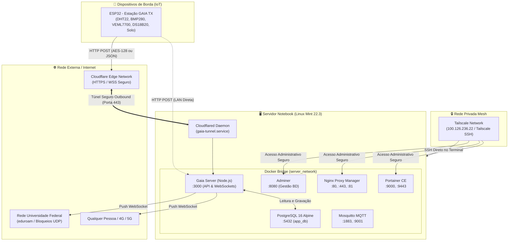
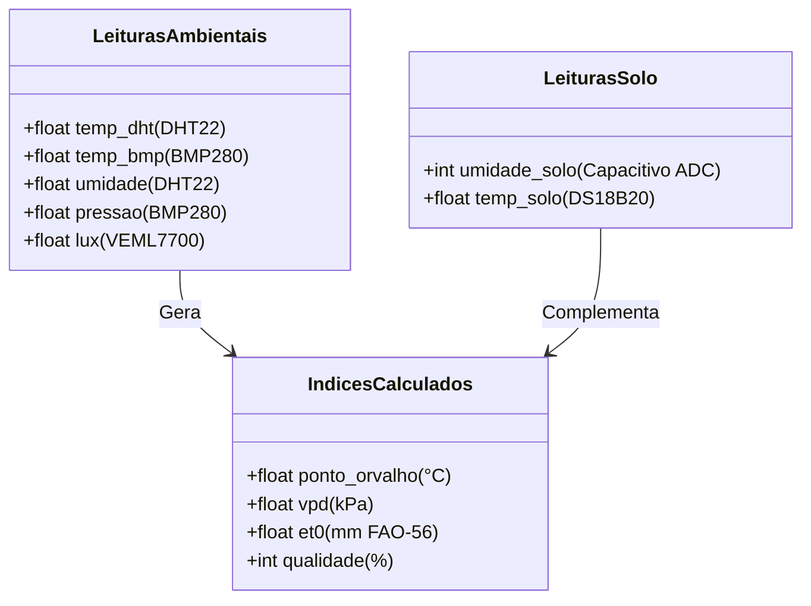

# 📚 Documentação Técnica Completa: Servidor Doméstico & Projeto GAIA

Este documento consolida a arquitetura completa, especificações de rede, configurações de hardware, serviços conteinerizados em Docker, estratégias de acesso remoto e a implementação do **Projeto GAIA (Estação Agroclimática Inteligente)**.

---

## 🏛️ 1. Arquitetura Geral do Sistema

O diagrama a seguir ilustra o fluxo de dados entre os dispositivos de campo (ESP32), a infraestrutura de rede, o servidor local e os clientes finais (navegadores em redes públicas e privadas):



---

## 💻 2. Especificações do Servidor Físico

* **Equipamento:** Notebook reaproveitado como servidor autônomo (bateria atua como nobreak natural contra microcortes de energia).
* **Sistema Operacional:** Linux Mint 22.3 (Zena) de 64 bits (base Ubuntu 24.04 LTS Noble Numbat).
* **Recursos de Hardware:**
  * **Processador:** Arquitetura x86_64.
  * **Memória RAM:** 6.0 GB (consumo em repouso da pilha inteira: **~145 MB**, com mais de 5 GB livres).
  * **Armazenamento:** SSD/HDD com 101 GB livres na partição `/`.
* **Gerenciamento de Energia da Tampa:**
  * Arquivo `/etc/systemd/logind.conf` configurado com `HandleLidSwitch=ignore`, `HandleLidSwitchExternalPower=ignore` e `HandleLidSwitchDocked=ignore`.
  * O notebook pode permanecer **fechado 24 horas por dia** sem entrar em suspensão ou desligar a tela/placa-mãe.
* **Acesso SSH:**
  * Usuário do sistema: `leo`
  * Autenticação por chave assimétrica **Ed25519** configurada em `~/.ssh/authorized_keys`.
  * Permissão de superusuário sem solicitação de senha configurada em `/etc/sudoers.d/leo` (`leo ALL=(ALL) NOPASSWD:ALL`).

---

## 🐳 3. Infraestrutura de Containers (Docker)

Toda a camada de software roda isolada através do **Docker CE 29.8** e **Docker Compose v5.5.1**, localizados no diretório `/home/leo/server/`.

### Matriz de Serviços e Portas

| Container | Imagem Base | Portas Mapeadas | Finalidade |
| :--- | :--- | :--- | :--- |
| `gaia-server` | `node:20-alpine` (Custom) | `3000:3000` | API de Ingestão de Telemetria e Dashboard em Tempo Real |
| `postgres` | `postgres:16-alpine` | `5432:5432` | Banco de dados relacional e persistência de medições |
| `adminer` | `adminer:latest` | `8080:8080` | Interface web ultraleve (~8 MB RAM) para gerenciar o banco |
| `portainer` | `portainer/portainer-ce:latest`| `9000:9000`, `9443:9443` | Painel gráfico web para monitorar containers, CPU e memória |
| `nginx-proxy-manager` | `jc21/nginx-proxy-manager:latest` | `80:80`, `81:81`, `443:443` | Proxy reverso e automação de certificados SSL Let's Encrypt |
| `mosquitto` | `eclipse-mosquitto:latest` | `1883:1883`, `9001:9001` | Broker MQTT de alta performance para mensagens IoT |

### Credenciais Padrão dos Serviços

> [!IMPORTANT]
> Recomenda-se alterar as senhas padrão no primeiro acesso através das interfaces web correspondentes.

* **PostgreSQL:**
  * Host interno (Docker): `postgres`
  * Host externo: `192.168.0.105` ou `100.126.236.22`
  * Porta: `5432`
  * Usuário: `server_admin`
  * Senha: `server_password_123`
  * Banco: `app_db`
* **Nginx Proxy Manager:**
  * Painel: `http://192.168.0.105:81`
  * Email inicial: `admin@example.com`
  * Senha inicial: `changeme`

---

## 🌐 4. Estratégia de Rede e Acesso Remoto

Para garantir disponibilidade contínua em qualquer cenário (mesmo em redes hostis e bloqueadas), foram adotadas duas camadas de conectividade:

### Camada A: Cloudflare Tunnels (Acesso Público e Universal)
* **Como funciona:** O daemon `cloudflared` estabelece 4 conexões simultâneas de saída (*outbound*) para a borda da Cloudflare usando TLS/QUIC na porta 443. Não há abertura de portas no roteador de casa (*sem port-forwarding*) e não é afetado por CGNAT.
* **Por que funciona na Universidade Federal:** Redes acadêmicas e corporativas bloqueiam portas não-padrão e conexões entrantes, mas liberam a porta 443 para navegação HTTPS comum. O tráfego do túnel é indistinguível de uma navegação web padrão.
* **Serviço do Sistema:** Gerenciado pelo `systemd` via `/etc/systemd/system/gaia-tunnel.service` com reinicialização automática em caso de falha.
* **URL Pública Oficial Ativa:**  
  👉 **`https://stunning-modeling-became-coverage.trycloudflare.com`**

### Camada B: Tailscale (Rede Privada Mesh)
* **Como funciona:** Cria uma rede VPN ponto a ponto cifrada com WireGuard entre seus dispositivos autorizados.
* **IP do Servidor na Tailnet:** `100.126.236.22`
* **Tailscale SSH:** Habilitado no servidor (`sudo tailscale set --ssh`), permitindo abrir uma sessão de terminal diretamente pelo navegador no painel administrativo da Tailscale.

---

## 🌾 5. Projeto GAIA: Especificação Técnica do Sistema

### 5.1. Esquema do Banco de Dados (`gaia_telemetria`)

```sql
CREATE TABLE IF NOT EXISTS gaia_telemetria (
  id SERIAL PRIMARY KEY,
  cod_estacao VARCHAR(16) NOT NULL,
  timestamp_utc BIGINT NOT NULL,
  data_hora TIMESTAMPTZ DEFAULT CURRENT_TIMESTAMP,
  temp_bmp NUMERIC(5,2),
  pressao NUMERIC(7,2),
  lux NUMERIC(8,2),
  umidade NUMERIC(5,2),
  temp_dht NUMERIC(5,2),
  umidade_solo INT,
  temp_solo NUMERIC(5,2),
  temp_ref NUMERIC(5,2),
  delta_temp NUMERIC(5,2),
  qualidade INT,
  ponto_orvalho NUMERIC(5,2),
  vpd NUMERIC(6,3),
  et0 NUMERIC(6,4),
  heap_mod INT,
  raw_payload JSONB
);

CREATE INDEX IF NOT EXISTS idx_gaia_estacao_ts 
ON gaia_telemetria (cod_estacao, timestamp_utc DESC);
```

### 5.2. Motor de Descriptografia e Compatibilidade de Ingestão

O backend (`server.js`) possui um mecanismo híbrido de detecção de carga:

1. **Payload Criptografado (AES-128-CBC):**
   * Envelope: `{"data": "<BASE64_STRING>"}`
   * Chave simétrica: `MARIACRYPTOKEY12` (16 bytes com padding)
   * Extração: Os primeiros 16 bytes do buffer binário decodificado são isolados como o Vetor de Inicialização (IV), e o restante é decifrado via `crypto.createDecipheriv('aes-128-cbc', key, iv)`.
2. **Payload JSON Puro:**
   * Caso o ESP32 envie JSON direto (`{"codSta":"G00001", "ts":1789862719, ...}`), o servidor faz o parsing imediato sem necessidade de decifração.

### 5.3. Variáveis Agroclimáticas Monitoradas



* **Déficit de Pressão de Vapor (VPD):**
  * Expressa a demanda evaporativa da atmosfera sobre os estômatos da planta.
  * **Classificação Agronômica em Tempo Real no Dashboard:**
    * `< 0.4 kPa`: Saturação hídrica, estagnação da transpiração e alto risco de fungos.
    * `0.4 a 0.8 kPa`: Transpiração moderada / condução hídrica lenta.
    * `0.8 a 1.25 kPa`: **Faixa Ideal** de abertura estomática e absorção máxima de nutrientes.
    * `1.25 a 1.6 kPa`: Transpiração acelerada, exige monitoramento do solo.
    * `> 1.6 kPa`: Estresse hídrico severo com fechamento estomático e paralisação do crescimento.
* **Evapotranspiração de Referência ($ET_0$ modelo FAO-56 Simplificado):**
  * Estima a perda diária de lâmina d'água acumulada (em milímetros) com base na temperatura de referência, radiação solar estimada em MJ a partir dos luximetros e pressão atmosférica.
* **Ponto de Orvalho ($T_{po}$):**
  * Temperatura na qual a água do ar condensa nas folhas da cultura.

---

## 📡 6. Guia de Integração para Firmware ESP32

No seu projeto de campo (`TX Telemetria.c` ou `TX_Telemetria.ino`), basta configurar a variável de endpoint conforme o ambiente:

### Ambiente de Teste / Bancada (Mesma Rede Wi-Fi)
```cpp
#define DEFAULT_SERVER_URL "http://192.168.0.105:3000/api/telemetria"
```

### Ambiente de Produção em Campo (Qualquer Rede Wi-Fi / 4G)
```cpp
#define DEFAULT_SERVER_URL "https://stunning-modeling-became-coverage.trycloudflare.com/api/telemetria"
```

> [!TIP]
> Caso adquira um domínio próprio futuro (ex: `gaiamonitor.com.br`), a URL se tornará definitiva (ex: `https://api.gaiamonitor.com.br/api/telemetria`).

---

## 🧰 7. Guia Operacional e Comandos de Manutenção

Todos os comandos devem ser executados via SSH no servidor:

```bash
# 1. Acessar o servidor via SSH do terminal Windows
ssh leo@192.168.0.105
# Ou remotamente pelo Tailscale:
ssh leo@100.126.236.22
```

### Gestão dos Containers
```bash
cd /home/leo/server

# Listar todos os serviços e status
docker compose ps

# Monitorar consumo de CPU e RAM em tempo real
docker stats

# Visualizar logs da API do Gaia em tempo real
docker logs -f gaia-server

# Reiniciar todos os serviços
docker compose restart

# Parar tudo e iniciar em segundo plano
docker compose down && docker compose up -d
```

### Gestão do Túnel Cloudflare
```bash
# Verificar status do serviço do túnel
sudo systemctl status gaia-tunnel.service

# Reiniciar o túnel
sudo systemctl restart gaia-tunnel.service

# Consultar a URL pública ativa gerada
cat /home/leo/server/URL_PUBLICA_GAIA.txt
```

### Backup do Banco de Dados
```bash
# Gerar dump completo do banco de dados em arquivo .sql
docker exec -t postgres pg_dump -U server_admin app_db > /home/leo/server/backup_gaia_$(date +%Y%m%d).sql
```
